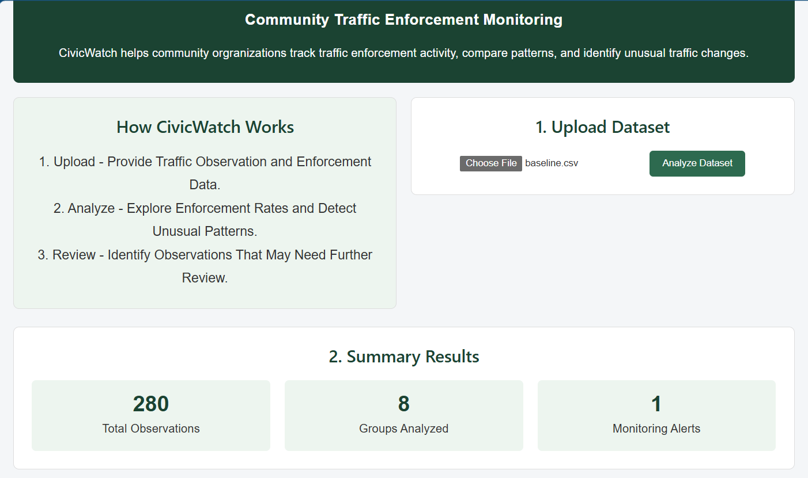
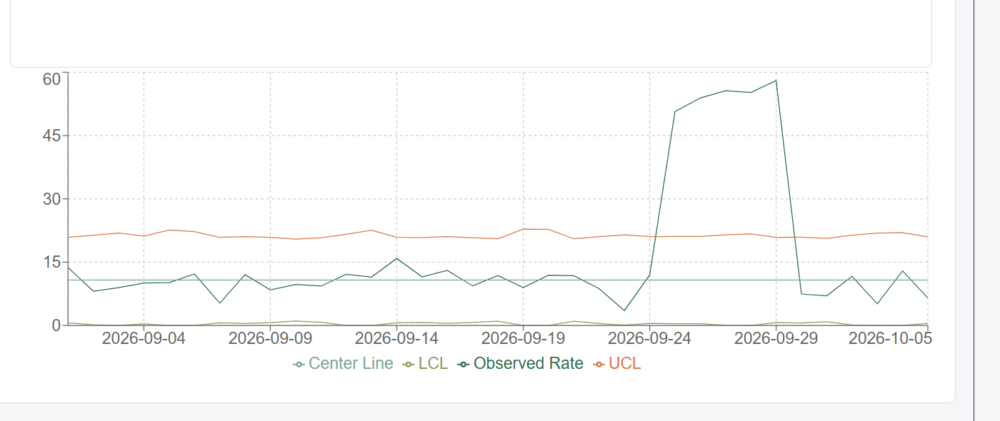
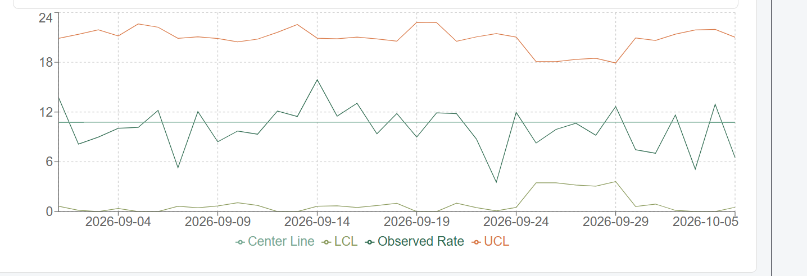

# CivicWatch: Guided demonstration with three synthetic datasets

**Cornell SYSEN 5300 Six Sigma Hackathon | Lean Leaders | Virtual Distance Learning**

This walkthrough demonstrates CivicWatch's baseline-only Poisson u-chart using three fully synthetic datasets. It can be completed by a reviewer in a desktop browser without installing development software. The purpose is to demonstrate statistical detection, not to assert that any real enforcement action was improper.

**Live application:** [Open the CivicWatch dashboard on Posit Connect](https://connect.systems-apps.com/content/0d9b2040-b25f-4d19-82ff-6f6f20b9511e/).

**Data downloads:** [`baseline.csv`](../data/baseline.csv), [`ticket_blitz.csv`](../data/ticket_blitz.csv), and [`traffic_surge.csv`](../data/traffic_surge.csv). Open a CSV in GitHub and choose **Download raw file**. The [dataset codebook](../data/README.md) explains each column.

## Instructions for the reviewer

1. Open the public dashboard in a desktop browser. It should load without a Posit Connect login.
2. Use **Choose File** to select one of the downloaded CSVs, then click **Analyze Dataset**.
3. Confirm that **Summary Results** lists 280 observations and 8 groups. Compare the monitoring alert count with the expected number below.
4. In **Control Chart**, select the specified zone and shift. Compare the observed rate with the center line, upper control limit (UCL), and lower control limit (LCL).
5. Scroll to **Monitoring Alerts** to identify flagged dates. Repeat for the remaining CSVs.

Every sample has 35 observation dates, four fictional zones (`Zone_A` to `Zone_D`), two shifts (`morning` and `evening`), and one observation for each combination. The first 21 dates (September 1–21, 2026) establish each zone/shift baseline. The last 14 dates (September 22–October 5) are monitoring observations. Only monitoring observations count toward the dashboard's alert total.

## Demonstration 1: Baseline scenario

**File:** [`baseline.csv`](../data/baseline.csv)

| Dashboard metric | Expected value |
| --- | ---: |
| Total observations | **280** |
| Groups analyzed | **8** |
| Monitoring alerts | **1** |

The simulation has no deliberately introduced enforcement blitz. It does contain one incidental above-limit observation at **Zone_A, evening, September 24, 2026**. Select **Zone_A** and **evening** in the control-chart selectors and inspect the observation near that date.

*Screenshot captured from the publicly deployed CivicWatch dashboard on October 21, 2026, showing the baseline summary.*

**Interpretation:** A generally stable process can still produce an isolated statistical control-limit exceedance due to random variation. One alert is not proof of a sustained change or misconduct.

## Demonstration 2: Simulated ticket blitz

**File:** [`ticket_blitz.csv`](../data/ticket_blitz.csv)

| Dashboard metric | Expected value |
| --- | ---: |
| Total observations | **280** |
| Groups analyzed | **8** |
| Monitoring alerts | **6** |

Select **Zone_C** and **evening**. The five observed rates for **September 25–29** should climb far above the upper control limit. Those five intentionally planted anomalous observations are flagged. The sixth alert is the same incidental Zone_A evening signal from the baseline scenario.

*Screenshot captured from the publicly deployed CivicWatch dashboard on October 21, 2026. The chart image is cropped to the plotted area; select Zone_C and evening to reproduce the view.*

**Quantitative check for the five target observations:** Across the five evenings, the sample includes **242 observed stops** among **4,425 vehicles**, a pooled rate of **54.69 stops per 1,000 vehicles**. The comparable zone/shift baseline center is approximately **10.77 per 1,000**. The five-day increase is deliberately injected into the synthetic data.

**Interpretation:** Because the observed stop rate increases markedly, not merely the number of passing vehicles, the Poisson u-chart detects all five planted monitoring signals. The result identifies observations for further review, not unlawful behavior.

## Demonstration 3: Traffic-volume surge

**File:** [`traffic_surge.csv`](../data/traffic_surge.csv)

| Dashboard metric | Expected value |
| --- | ---: |
| Total observations | **280** |
| Groups analyzed | **8** |
| Monitoring alerts | **1** |

Again select **Zone_C** and **evening**. In the five-day September 25–29 window, the number of observed vehicles doubles while the underlying enforcement stop rate remains unchanged. The **UCL and LCL move closer together** as the exposure increases, and the observed rates remain within these limits on all five target evenings.

*Screenshot captured from the publicly deployed CivicWatch dashboard on October 21, 2026. The chart image is cropped to the plotted area; select Zone_C and evening to reproduce the view.*

**Quantitative check for the five target observations:** The surge scenario contains **90 observed stops** among **8,850 vehicles**, yielding **10.17 stops per 1,000**. The corresponding baseline scenario has **45 stops** among **4,425 vehicles**, also **10.17 per 1,000**. No target evening is flagged. The one dashboard alert is again the unrelated September 24 Zone_A chance signal.

**Interpretation:** More observed stops caused by more passing vehicles are not necessarily an increase in stop *rate*. An exposure-adjusted u-chart avoids falsely flagging these five higher-volume observations as anomalous.

## Compare the three scenarios

| Dataset | Total observations | Groups | Total monitoring alerts | Alerts among the five target Zone_C evenings |
| --- | ---: | ---: | ---: | ---: |
| Baseline | 280 | 8 | **1** | **0** |
| Ticket blitz | 280 | 8 | **6** | **5** |
| Traffic surge | 280 | 8 | **1** | **0** |

**Main takeaway:** CivicWatch detects a simulated rise in stop *intensity* while accounting for varying observed traffic volumes. All three scenarios share the same baseline period, so the differences in results come from the injected monitoring conditions, not a change in how the historical limit was estimated.

## What each chart line means

The analysis operates independently for each `(zone_id, shift)` group:

- **Observed rate:** `1000 * stops_observed / vehicles_observed` on each day.
- **Center line:** `1000 * total_baseline_stops / total_baseline_vehicles` for the selected zone and shift.
- **UCL:** Center plus three Poisson standard deviations using that observation's vehicle exposure.
- **LCL:** Center minus three Poisson standard deviations using the same exposure, floored at zero.
- **Signal:** A **monitoring** rate strictly outside its control limits.

The limits are statistical thresholds, **not** policy authorization limits or legal judgments. The observations and the authorization context in these three files are fictional. The application does not determine intent, bias, discrimination, or violations of law.

## Reproduce the calculations without the dashboard

The same engine can be run and tested from the repository. See the [main README](../README.md) for installation and local testing, [`app/qc.py`](../app/qc.py) for the independent Poisson u-chart implementation, and [`data/VALIDATION.md`](../data/VALIDATION.md) for planted counts and the known-answer calculation. The FastAPI backend also exposes interactive documentation at [the deployed `/docs` endpoint](https://connect.systems-apps.com/content/c1c8025f-66c6-46dc-ad09-0cea7e56dca1/docs).

## Demonstration evidence and verification note

The team verified all three datasets on the **publicly deployed dashboard** on October 21, 2026, obtaining monitoring alert counts of **1, 6, and 1**. The screenshots above were captured from the current public desktop deployment on October 21, 2026. The two control-chart screenshots are cropped to the plotting area; the selected zone and shift are documented in the walkthrough text. The team also verified all three scenario alert totals in the live interface.

A working application with transparent synthetic test data is a prompt for investigation and quality-control learning, not a substitute for trained field observers, careful sampling, or professional legal analysis.
